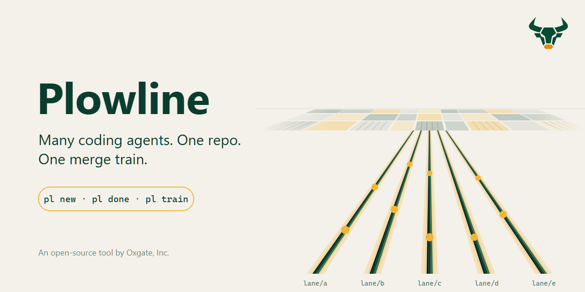
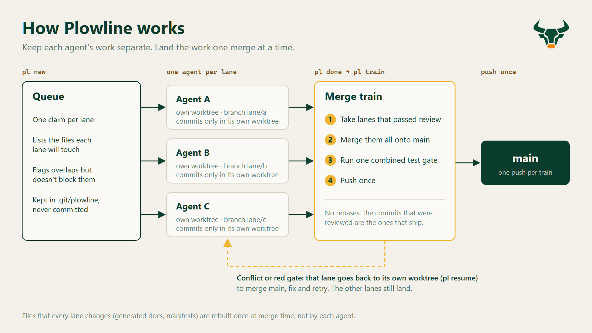
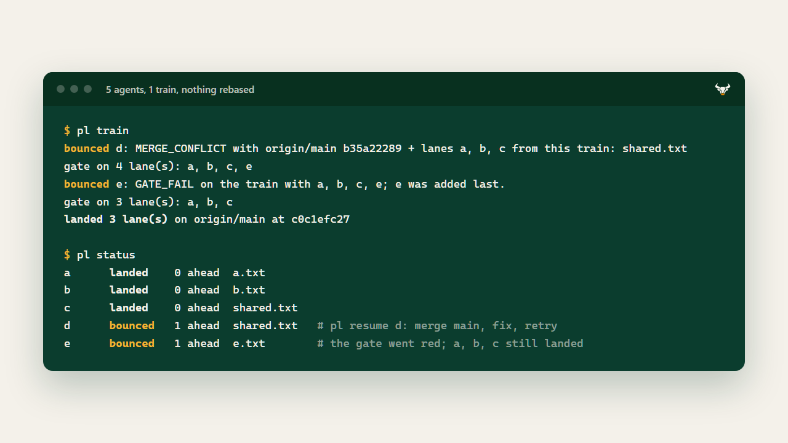
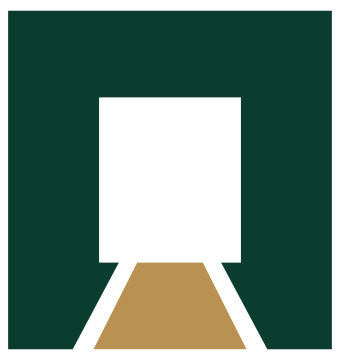

<p align="center"></p>

Run several coding agents (Claude Code, Codex, anything that edits files) on one
repository without them stepping on each other.

- **A lane per agent.** Each agent works in its own git worktree on its own
  branch, so no two agents ever share a working tree.
- **A queue that knows who touches what.** Each lane claims the files it expects to change.
  Overlaps are flagged, not blocked.
- **A merge train.** Finished lanes are merged together onto the trunk, tested
  once as a whole, and pushed once.
- **Bounce, don't block.** A lane that conflicts or turns the gate red goes back
  to its own worktree with a note. The other lanes still land.
- **No rebases.** The commits that were reviewed are the commits that ship.

<p align="center"></p>

## Quickstart

Needs Python 3.11+ and git 2.31+. No other dependencies.

```bash
pipx install git+https://github.com/oxgate-inc/plowline
cd your-repo
yard init                 # writes plowline.toml; set `gate` to your test command, commit it
```

Start lanes and point one agent at each worktree:

```bash
yard new login-page --paths src/auth/ --brief briefs/login.md
yard new rate-limits --paths src/api/limits.py
yard status
```

When an agent has committed its work:

```bash
yard done login-page      # runs the reviewer, makes the lane a candidate
yard train                # merge candidates onto main, gate once, push once
```

If a lane bounces:

```bash
yard resume rate-limits   # prints why, and the merge-main-and-fix steps
```

`yard clean` removes the worktrees and branches of lanes that landed.

<p align="center"></p>

Watch it end to end in a throwaway repo:

```bash
python examples/demo.py
```

## Have an agent set it up

Point your agent at [AGENT-SETUP.md](AGENT-SETUP.md). It installs Plowline,
finds your test command, adds the lane rules to `AGENTS.md` / `CLAUDE.md`, and
proves the setup with the demo.

## Configuration

`plowline.toml` at the repo root:

```toml
[plowline]
trunk = "main"
remote = "origin"
gate = "python -m pytest -q"     # must pass on the merged train before anything is pushed
review = "builtin:claude"        # see Review below
regenerate = ""                  # optional: rebuild generated files on the merged tree
worktrees = "../{repo}-lanes"    # where lane worktrees live
```

Lane state lives in `.git/plowline/`. It is never committed and never pushed.

### Review

`yard done` runs a reviewer before a lane can join a train.

| `review =` | What runs |
|---|---|
| `""` | No review. Every finished lane is a candidate. |
| `"builtin:claude"` | `claude -p` reads the lane's brief and diff and answers GO or NO-GO. |
| `"builtin:codex"` | The same prompt through `codex exec`. |
| any command | Runs in the lane's worktree. Exit 0 is GO, and its output becomes the note. It gets `PLOWLINE_LANE`, `PLOWLINE_BRANCH`, `PLOWLINE_BASE`, `PLOWLINE_HEAD` and `PLOWLINE_WORKTREE`. |

The reviewer is a gate, not a substitute for your tests. Keep the real checks in `gate`.

### How a train decides

1. Take every candidate, oldest first.
2. Merge each onto the current trunk in a scratch worktree. A candidate that
   conflicts is bounced with the conflicting paths, and the rest continue.
3. Run `regenerate` if set, then `gate`, on the merged tree.
4. If the gate is red, drop the last-added lane (the only one the evidence
   isolates), bounce it, and run the gate again on the rest.
5. Push once. If the trunk moved underneath, nothing is marked landed. Run the train again.

## Why trunk-based, not gitflow?

A `develop` branch is a second merge point, and with a dozen agents that means
twice the drift. Keep one trunk, land through the train, and control releases by
promoting the same tested commit through environments (staging, then
production). Put human approvals on those promotions rather than on another branch.

## Limits

- One train at a time per repository (a lock file enforces it).
- Overlap detection is path-based. It warns, it does not reason about semantics.
- The train pushes to a remote. For a purely local repo, add a bare remote.

## License

Apache-2.0. See [LICENSE](LICENSE).

---

<sub> Built by <a href="https://oxgate.ai">Oxgate</a>. We run our own agents this way.</sub>
